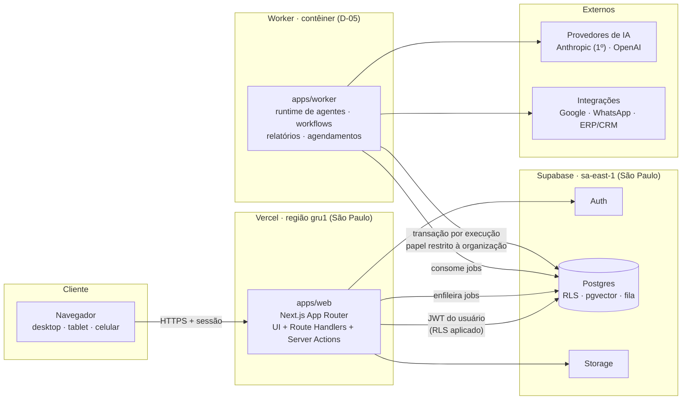

# 03 — Arquitetura do sistema (V1)

> Status: **proposta aguardando aprovação** (ver [09-decisoes-pendentes.md](09-decisoes-pendentes.md)).
> Decisões individuais registradas em [`docs/adr/`](adr/README.md).

## 1. Visão geral

**Monolito modular** em um monorepo: uma aplicação Next.js (interface + API) e um **worker** Node
(execuções de agentes, workflows, relatórios agendados), ambos usando os mesmos pacotes de domínio e o
mesmo Postgres (Supabase). Sem microsserviços na V1 — as fronteiras de pacote permitem extrair serviços
quando houver motivo medido para isso.



### Princípios

1. **O banco é a fronteira de isolamento.** Toda tabela de domínio tem `org_id` e RLS. O código da
   aplicação também filtra por organização (defesa em profundidade), mas um bug no código não pode
   expor dados de outra empresa.
2. **O modelo sugere, o código decide.** Execução de ferramentas, aprovação, limites e permissões são
   decididos por código determinístico e testado (`packages/core`), nunca pelo texto gerado pelo modelo.
3. **Tudo que um agente faz é rastreável.** Execução → passos → chamadas de ferramenta → aprovações →
   resultado, com custo e autoria, persistidos no Postgres.
4. **Nada de SDK de fornecedor espalhado.** Provedores de IA e integrações entram por interfaces
   próprias (`packages/ai`, `packages/integrations`).
5. **Demonstração é marcada.** Dados de demonstração têm `is_demo = true` e aparecem rotulados na UI.

## 2. Componentes

| Componente | Responsabilidade | Status |
|---|---|---|
| `apps/web` | UI do centro de controle, autenticação (sessão via cookies), API síncrona (Route Handlers / Server Actions), enfileiramento de trabalho. **Nunca** executa agentes nem usa a chave secreta do Supabase. | Fase 1 |
| `apps/worker` | Consome a fila: execuções de agentes, passos de workflow, relatórios agendados, ingestão da memória (extração, chunking, embeddings). | Fase 2 |
| `packages/core` | Domínio puro, sem dependências: papéis e permissões, política de ações de agentes, limites de execução, tipos compartilhados. | **Iniciado** ✅ |
| `packages/ai` | Contrato agnóstico de provedor (`ModelProvider`, `EmbeddingProvider`), catálogo de modelos e estimativa de custo; adaptadores (Anthropic primeiro). | **Contrato iniciado** ✅ |
| `packages/db` | Clientes Supabase/Postgres, tipos gerados do schema, helper `withTenant()` para o worker, repositórios por módulo. | Fase 1 |
| `packages/agents` | Runtime: registro de ferramentas, loop do agente, aplicação da política, pausa para aprovação, delegação. | Fase 2 |
| `packages/memory` | Ingestão de documentos, chunking, embeddings, busca híbrida (vetorial + texto) com escopo de organização. | Fase 3 |
| `packages/workflows` | Definições versionadas de fluxos, gatilhos, motor de execução sobre a fila. | Fase 5 |
| `packages/integrations` | SDK de conectores (manifesto, autenticação, ferramentas com classe de risco) e conectores reais. | Fase 6 |
| `packages/ui` | Design system: tokens (cores, tipografia, movimento), componentes reutilizáveis. | Fase 1 |
| `supabase/` | Migrações SQL (fonte da verdade do schema), políticas RLS, seed de demonstração, testes de banco. | **Iniciado** ✅ |

## 3. Fluxo de uma execução de agente

```mermaid
sequenceDiagram
  autonumber
  actor U as Usuário
  participant W as apps/web
  participant DB as Postgres (RLS)
  participant K as apps/worker
  participant AI as packages/ai → provedor
  participant H as Aprovador

  U->>W: cria tarefa para o agente "Financeiro"
  W->>DB: insert task + agent_run (queued) + job
  K->>DB: pega job; abre transação com papel magnus_agent e org_id fixado
  K->>DB: carrega agente, ferramentas autorizadas, contexto da memória
  loop até concluir ou atingir limite
    K->>AI: generate(system, histórico, ferramentas)
    AI-->>K: texto e/ou chamadas de ferramenta + uso de tokens
    K->>K: evaluateToolCall() — política por classe de risco
    alt permitido
      K->>K: executa ferramenta, registra passo e custo
    else requer aprovação
      K->>DB: approval (pending); run → waiting_approval
      DB-->>H: notificação na caixa de aprovações
      H->>W: aprova / rejeita
      W->>DB: decisão registrada + job de retomada
    else negado
      K->>AI: devolve erro estruturado ao modelo
    end
  end
  K->>DB: resultado, uso, auditoria; run → completed
  W-->>U: dashboard e notificação atualizados
```

**Comunicação entre agentes** é uma ferramenta de **delegação**: cria uma subtarefa vinculada
(`parent_run_id`), na mesma organização, com profundidade incrementada e orçamento herdado. Não existe
canal livre de mensagens entre agentes — todo intercâmbio é uma tarefa persistida e auditável.

## 4. Avaliação da stack proposta

| Proposta do briefing | Decisão | Justificativa |
|---|---|---|
| Next.js + TypeScript | ✅ Mantido (Next.js 16, App Router) | Melhor ecossistema para SaaS em React; Server Components reduzem JS no cliente; hospedagem madura. |
| Tailwind CSS + componentes reutilizáveis | ✅ Mantido (Tailwind 4) + design system próprio em `packages/ui` | Componentes acessíveis partindo de primitivas Radix (via código copiado, estilo shadcn/ui, sem dependência de tema genérico), customizados para a identidade MAGNUS. |
| Backend em TypeScript | ✅ Ajustado: API síncrona no próprio Next.js + **worker dedicado** para trabalho assíncrono | Execuções de agentes duram de segundos a minutos e pausam para aprovação; isso não cabe em funções serverless. Um servidor de API separado seria infraestrutura extra sem ganho na V1. |
| PostgreSQL | ✅ Mantido — e ampliado: também fila e vetores | Um único sistema para proteger, auditar e fazer backup. |
| Supabase | ✅ Mantido (Auth, Postgres, Storage), região São Paulo | RLS nativo integrado ao Auth é a base do isolamento multiempresa; Postgres padrão mantém portabilidade. |
| Anthropic + OpenAI | ✅ Mantido atrás de camada própria; **Anthropic primeiro** | Claude para raciocínio e uso de ferramentas; a Anthropic não oferece embeddings, então a memória precisará de um provedor de embeddings (OpenAI ou Voyage — [D-07](09-decisoes-pendentes.md)). |
| n8n | ❌ **Fora do núcleo do produto** | Licença não permite oferecê-lo como serviço a clientes sem contrato específico; modelo de credenciais e isolamento não é multiempresa como precisamos; aprovações e rastreabilidade de agentes precisam ser nativas. Pode ser usado internamente pela equipe ([ADR-0006](adr/0006-n8n-fora-do-nucleo.md)). |
| Git + GitHub | ✅ Mantido | Repositório privado, `main` protegida, PRs com CI (typecheck, testes, varredura de segredos). |
| Hospedagem compatível com Next.js | ✅ Vercel (web, região `gru1`) + contêiner para o worker ([D-05](09-decisoes-pendentes.md)) | Vercel é o caminho de menor atrito para Next.js; o worker precisa de processo de longa duração. |
| — (não previsto) | ➕ **pg-boss** (fila no Postgres) | Fila durável, retries, agendamento (cron) sem infraestrutura nova ([ADR-0004](adr/0004-worker-e-fila-no-postgres.md)). |
| — (não previsto) | ➕ **pgvector** | Busca vetorial no mesmo banco, protegida pela mesma RLS ([ADR-0007](adr/0007-pgvector-no-postgres.md)). |

## 5. Estrutura de pastas e módulos

```text
magnus-os/
├── apps/
│   ├── web/                    # Fase 1 — Next.js (centro de controle + API)
│   │   └── src/
│   │       ├── app/            # rotas: (auth), (app)/[org]/dashboard, agents, tasks, memory, approvals, settings
│   │       ├── components/     # componentes específicos de tela
│   │       ├── server/         # actions e handlers; autorização via packages/core
│   │       └── lib/            # supabase (ssr), formatação, i18n
│   └── worker/                 # Fase 2 — consumidor da fila
│       └── src/jobs/           # agent-run, memory-ingest, report-schedule, workflow-step
├── packages/
│   ├── core/          ✅       # domínio puro: tenancy, permissions, agent-policy
│   ├── ai/            ✅       # contrato de provedores + catálogo; adapters/ na Fase 2
│   ├── db/                     # Fase 1 — clientes, tipos gerados, withTenant()
│   ├── agents/                 # Fase 2 — runtime, ferramentas, aprovações
│   ├── memory/                 # Fase 3 — ingestão e recuperação
│   ├── workflows/              # Fase 5 — motor de fluxos
│   ├── integrations/           # Fase 6 — SDK de conectores + conectores
│   └── ui/                     # Fase 1 — design system
├── supabase/
│   ├── migrations/    ✅       # SQL versionado (fonte da verdade)
│   ├── tests/         ✅       # testes de RLS/isolamento (PGlite)
│   └── seed.sql                # Fase 1 — dados de demonstração (is_demo = true)
├── docs/              ✅       # produto, arquitetura, ADRs, segurança, roadmap
├── CLAUDE.md          ✅       # regras do projeto para sessões do Claude Code
└── CHANGELOG.md       ✅       # registro do que foi implementado
```

Regra de dependência entre pacotes (sem ciclos):

```text
core  ←  ai  ←  agents  ←  workflows
  ↑       ↑       ↑
  db  ←  memory   integrations
  ↑
apps/web · apps/worker  (únicos que montam tudo)
```

`packages/core` não importa nada. Nenhum pacote importa `apps/*`. SDKs de fornecedores só existem dentro
de `packages/ai/src/adapters/` e `packages/integrations/src/connectors/`.

## 6. Dependências

Política: cada dependência precisa de justificativa, manutenção ativa e versão fixada (sem `^`).
Versões abaixo consultadas no npm em 2026-11-01; serão confirmadas na instalação de cada fase.

| Pacote | Uso | Fase | Observação |
|---|---|---|---|
| `typescript` 7.0.x | Verificação de tipos | 0 ✅ | Compilador nativo; compatibilidade com Next.js 16 a confirmar na Fase 1. |
| `@types/node` 24.x | Tipos do Node 24 (LTS) | 0 ✅ | |
| `@electric-sql/pglite` 0.5.x | Postgres em WASM para testar migrações e RLS sem Docker | 0 ✅ | Só desenvolvimento/CI. |
| `next` 16.x, `react`/`react-dom` 19.x | App web | 1 | |
| `tailwindcss` 4.x | Estilos | 1 | |
| `@supabase/supabase-js` 2.x, `@supabase/ssr` | Cliente com sessão do usuário (RLS) | 1 | |
| `zod` 4.x | Validação de entrada (forms, API, entradas de ferramentas) | 1 | |
| `@radix-ui/*` (seletivo) | Primitivas acessíveis (dialog, menu, tooltip) | 1 | Apenas as usadas. |
| `@playwright/test` | Testes ponta a ponta (fluxos críticos e isolamento) | 1 | |
| `@anthropic-ai/sdk` 1.x | Adaptador Anthropic | 2 | Só em `packages/ai/src/adapters/`. |
| `pg-boss` | Fila e agendamentos no Postgres | 2 | |
| `postgres` (postgres.js) | Conexão direta do worker (transação por execução) | 2 | |
| Provedor de embeddings (`openai` ou Voyage) | Memória empresarial | 3 | [D-07](09-decisoes-pendentes.md) |
| Extratores de documento (PDF/DOCX/XLSX) | Ingestão da memória | 3 | Escolha na fase, com avaliação de segurança (arquivos não confiáveis). |

Fora da lista de propósito: ORMs pesados, bibliotecas de estado global no cliente, frameworks de agentes
de terceiros (o loop do agente é nosso — ver [ADR-0003](adr/0003-camada-de-ia-propria.md)).

## 7. Acesso a dados

- **Web**: `supabase-js` com o JWT do usuário → RLS aplicada automaticamente. A chave secreta não existe
  no ambiente do app web.
- **Worker**: conexão Postgres direta. Cada execução roda em uma transação com `set local role
  magnus_agent` e `magnus.org_id` fixado; as políticas RLS também valem para esse papel. Um bug no worker
  não consegue ler outra organização dentro da transação de uma execução. (Implementação na Fase 2.)
- **Operações administrativas** (purga, manutenção) usam o papel de serviço, apenas em jobs específicos,
  sempre auditados.

## 8. Ambientes

| Ambiente | Web | Banco | Uso |
|---|---|---|---|
| Local | `next dev` | PGlite (testes) e/ou projeto Supabase de desenvolvimento | Desenvolvimento |
| Staging | Vercel (preview/staging) | Projeto Supabase `magnus-staging` (sa-east-1) | Validação, demos com dados de demonstração |
| Produção | Vercel (gru1) | Projeto Supabase `magnus-prod` (sa-east-1) | Clientes |

Segredos apenas em variáveis de ambiente dos provedores de hospedagem; nunca no repositório
(ver [`.env.example`](../.env.example)).

## 9. Observabilidade

- Cada execução de agente gera um rastro persistido (passos, ferramentas, tokens, custo, latência, erros).
- Logs estruturados (JSON) com `org_id`, `run_id` e `request_id`; nunca conteúdo de documentos ou tokens.
- Métricas de negócio no próprio Postgres na V1 (execuções, aprovações, custo por organização);
  ferramenta externa de APM/erros (ex.: Sentry) a decidir na Fase 1.

## 10. Caminho de escala

Ordem esperada, só quando medições justificarem: índices e particionamento por tempo das tabelas de
auditoria e passos → réplicas de leitura → múltiplas instâncias do worker (a fila já suporta) →
extração do runtime de agentes como serviço → banco de vetores dedicado (se pgvector virar gargalo).
