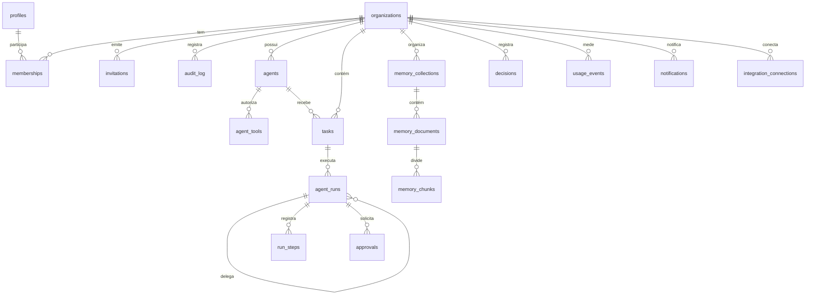

# 04 — Estrutura do banco de dados

> Fonte da verdade: [`supabase/migrations/`](../supabase/migrations/). Este documento explica as regras e
> mostra o modelo-alvo da V1. Status de cada tabela indicado abaixo.

## 1. Regras obrigatórias para toda tabela de domínio

1. **`org_id uuid not null`** referenciando `organizations(id)`. Sem exceção para dados de clientes.
2. **RLS habilitada** com políticas explícitas por operação (`select`, `insert`, `update`, `delete`).
   Tabela sem política = ninguém acessa (padrão seguro).
3. **Privilégios explícitos** (`revoke` + `grant` por coluna quando fizer sentido); nunca depender dos
   privilégios padrão da plataforma.
4. **FKs compostas** entre tabelas de domínio: a tabela-pai declara `unique (org_id, id)` e a filha
   referencia `(org_id, x_id)`. Assim o banco **rejeita** uma tarefa da empresa A apontando para um
   agente da empresa B, mesmo que o código erre.
   ```sql
   create table public.agents (
     id uuid primary key default gen_random_uuid(),
     org_id uuid not null references public.organizations (id) on delete cascade,
     ...,
     unique (org_id, id)
   );
   create table public.tasks (
     id uuid primary key default gen_random_uuid(),
     org_id uuid not null references public.organizations (id) on delete cascade,
     agent_id uuid not null,
     foreign key (org_id, agent_id) references public.agents (org_id, id)
   );
   ```
5. **Teste de isolamento** em `supabase/tests/` para cada tabela nova: outro tenant não lê, não altera,
   não referencia.
6. Chaves `uuid` (`gen_random_uuid()`), datas `timestamptz`, JSON em `jsonb` com `check` de tipo.
7. Funções `security definer` sempre com `set search_path = ''` e nomes qualificados.
8. Dados de demonstração marcados com `is_demo boolean not null default false` nas tabelas que os recebem.

## 2. Papéis

`public.org_role` = `viewer < member < admin < owner` (a ordem de declaração do enum é a ordem de
privilégio). Regras: owners gerenciam todos; admins gerenciam apenas members e viewers e não concedem
admin/owner; toda organização mantém ao menos um owner. Espelhado em `packages/core/src/tenancy.ts`.

## 3. Modelo-alvo da V1



| Tabela | Finalidade | Fase | Status |
|---|---|---|---|
| `organizations` | Raiz do tenant (nome, slug, configurações). | 0 | ✅ migração `20261101000000` |
| `profiles` | Dados exibíveis do usuário (1:1 com `auth.users`, criado por gatilho). | 0 | ✅ |
| `memberships` | Vínculo usuário ↔ organização com papel. | 0 | ✅ |
| `audit_log` | Trilha append-only de eventos de segurança e ações de agentes. | 0 | ✅ |
| `invitations` | Convites com hash de token, expiração, papel proposto. | 1 | planejada |
| `agents` | Identidade, especialidade, objetivo, responsabilidades, instruções, autonomia, limites, modelo. | 2 | planejada |
| `agent_tools` | Ferramentas autorizadas por agente (nome, configuração). A classe de risco vem do código, não do banco. | 2 | planejada |
| `tasks` | Trabalho atribuído a um agente (origem: pessoa, agenda, workflow, delegação). | 2 | planejada |
| `agent_runs` | Cada execução: status, `parent_run_id`, profundidade, modelo, tokens, custo estimado. | 2 | planejada |
| `run_steps` | Passos da execução: mensagens, chamadas de ferramenta, resultados, decisões de política. | 2 | planejada (particionar por tempo quando crescer) |
| `approvals` | Pedido de aprovação: ação proposta, entrada, solicitante (agente), decisão, decisor, justificativa. | 2 | planejada |
| `usage_events` | Medição por chamada de modelo (org, run, modelo, tokens, custo estimado). | 2 | planejada |
| `memory_collections` | Agrupamentos da memória com controle de acesso. | 3 | planejada |
| `memory_documents` | Documento de origem (arquivo no Storage, hash, status de ingestão). | 3 | planejada |
| `memory_chunks` | Trechos + `embedding vector(N)` + `embedding_model` + `tsvector` para busca híbrida. | 3 | planejada (N depende de D-07) |
| `decisions` | Histórico de decisões: contexto, decisão, responsáveis, fontes. | 3 | planejada |
| `notifications`, `reports`, `alerts` | Saídas para pessoas. | 4 | planejadas |
| `workflows`, `workflow_versions`, `workflow_runs` | Motor de fluxos. | 5 | planejadas |
| `integration_connections`, `integration_credentials` | Conexões por organização; credenciais cifradas em nível de aplicação. | 6 | planejadas |

## 4. Acesso do worker (Fase 2)

Um papel de banco `magnus_agent` (sem `BYPASSRLS`) receberá políticas do tipo
`org_id = current_setting('magnus.org_id')::uuid`. O worker abre uma transação por execução,
`set local role magnus_agent` e fixa `magnus.org_id`; assim o próprio worker fica restrito à
organização da tarefa.

## 5. Ciclo de vida e retenção

- **Exclusão de organização:** processo do servidor (não disponível ao cliente): marca para exclusão,
  período de carência, exportação disponível, depois purga em cascata — inclusive arquivos no Storage
  e vetores.
- **Auditoria:** retida enquanto a organização existir; registros de acesso à aplicação retidos por no
  mínimo 6 meses (Marco Civil da Internet, art. 15) em armazenamento próprio.
- **Passos de execução:** retenção configurável por organização (padrão a definir com clientes).

## 6. Como testar

```bash
npm run test:db
```

Sobe um Postgres em memória (PGlite), aplica um shim mínimo do Supabase (`supabase/tests/support/`) e
todas as migrações em ordem, e executa os cenários como `anon`, usuários autenticados e `service_role`.
