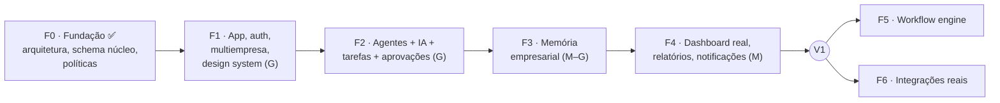

# 08 — Roadmap técnico e próximas etapas

> Cada fase termina com uma entrega **verificável** (critério "pronto quando"). Tamanhos relativos:
> P (dias), M (1–2 semanas), G (3+ semanas), estimados para um desenvolvedor com Claude Code.
> Datas dependem de equipe e das decisões em [09](09-decisoes-pendentes.md).

## Ordem proposta e o porquê

O briefing lista: estrutura → autenticação → multiempresa → **dashboard** → agentes → IA → memória →
tarefas → relatórios. Mantive a ordem, com um ajuste: o **dashboard** ganha o layout e a navegação na
Fase 1, mas seus **indicadores reais** chegam na Fase 4, quando existirem execuções, tarefas e custos
para medir. Antes disso, um dashboard só poderia mostrar números inventados — exatamente o que o
briefing pede para evitar. Agentes, IA e tarefas formam um único fluxo (tarefa → execução → resultado)
e por isso estão juntos na Fase 2.

## Fase 0 — Fundação ✅ (esta entrega)

- Análise, riscos, arquitetura, ADRs, roadmap e decisões pendentes.
- Migração do núcleo multiempresa (organizações, perfis, vínculos, auditoria) com RLS e **12 testes de
  isolamento** executados contra Postgres real (PGlite).
- `packages/core`: papéis, permissões e política de ações de agentes, com testes.
- `packages/ai`: contrato agnóstico de provedor, catálogo de modelos e estimativa de custo, com testes.

Bloco A de decisões aprovado em 2026-11-01. Projeto movido para `C:\dev\magnus-os`, Git inicializado,
CI escrito. Repositório privado `EnzoSaretti/Magnus-OS` criado e `main` enviada.

## Fase 1 — Aplicação, autenticação e multiempresa (G)

Dividida em incrementos, cada um com commit e verificação próprios:

| Incremento | Conteúdo | Depende de | Status |
|---|---|---|---|
| **F1.1 Infraestrutura** | Repositório GitHub, CI, proteção da `main`; projeto Supabase de staging (sa-east-1) com migrações aplicadas; `supabase/config.toml`; tipos gerados. | D-02, conta Supabase | GitHub, CI e staging ✅ (3 migrações aplicadas, isolamento verificado no banco real). Pendentes: Supabase CLI + `config.toml` e tipos gerados (entram com `packages/db` na F1.4); proteção da `main` exige GitHub Pro |
| **F1.2 Convites no banco** | Tabela `invitations` (hash do token, expiração, uso único, e-mail do convidado), `create_invitation`, `accept_invitation`, RLS e testes. | — | ✅ Concluído (2026-11-01) |
| **F1.3 App web e design system** | `apps/web` (Next.js 16, Tailwind 4), `packages/ui` com tokens da identidade, layout de "centro de controle" responsivo (desktop/tablet/celular). | D-12, D-13 (logo pode entrar depois) | ✅ Concluído (2026-11-02): shell responsivo, Painel e telas dos módulos sem dados fictícios; logotipo pendente (D-13) |
| **F1.4 Autenticação** | Supabase Auth via `@supabase/ssr`: e-mail + senha, link mágico, Google; MFA (TOTP) obrigatório para owner/admin. | F1.1, F1.3 | Planejado |
| **F1.5 Organizações na interface** | Onboarding (criar organização), seletor, membros e papéis, envio e aceite de convites, visualizador de auditoria. | F1.2, F1.4, provedor de e-mail transacional (D-16) | Planejado |
| **F1.6 Qualidade e staging** | Seed de demonstração (`is_demo`), testes E2E (Playwright) de isolamento entre organizações, deploy de staging. | F1.5, D-05 | Planejado |

**Pronto quando:** duas organizações criadas por usuários diferentes em staging não enxergam dados uma
da outra em nenhuma tela ou chamada de API (teste E2E automatizado); convite → aceite → papel correto
funciona ponta a ponta; MFA exigido para admins.

## Fase 2 — Agentes, IA, tarefas e aprovações (G)

- Schema: `agents`, `agent_tools`, `tasks`, `agent_runs`, `run_steps`, `approvals`, `usage_events`
  (todas com `org_id`, RLS e FKs compostas).
- `packages/ai`: adaptador Anthropic (SDK oficial), streaming, erros normalizados, medição de uso.
- `apps/worker` + pg-boss: execução de tarefas, retomada após aprovação, retries idempotentes.
- `packages/agents`: registro de ferramentas com classe de risco; ferramentas internas iniciais
  (consultar tarefas, criar nota, delegar para outro agente, registrar decisão); aplicação da política.
- UI: Agent Manager (identidade, especialidade, objetivo, responsabilidades, ferramentas, autonomia,
  limites), caixa de tarefas, caixa de aprovações, linha do tempo de cada execução.
- Orçamento mensal por organização; limites por execução.

**Pronto quando:** um agente real recebe uma tarefa, usa uma ferramenta interna, para em uma ação
sensível até um admin aprovar, conclui, e toda a execução (passos, custo, aprovador) aparece no
rastro; testes cobrem isolamento das novas tabelas e o caminho de aprovação.

## Fase 3 — Memória empresarial (M–G)

- Upload de PDF, DOCX, XLSX/CSV e texto para Storage com caminho por organização + RLS.
- Ingestão no worker: extração, chunking, embeddings (D-07), pgvector + busca textual (híbrida).
- Coleções com controle de acesso; registro de decisões (o que foi decidido, por quem, com base em quê).
- Ferramenta `search_company_memory` para agentes, com citações às fontes.

**Pronto quando:** um agente responde citando o documento correto da própria organização e nunca
recupera trechos de outra (teste de isolamento na busca vetorial); exclusão de documento remove
chunks e vetores.

## Fase 4 — Dashboard real, relatórios e notificações (M)

- Indicadores a partir de dados reais: execuções, taxa de sucesso, aprovações pendentes, custo por
  agente, alertas abertos.
- Relatórios agendados por agente (resumo diário/semanal), alertas (problemas e oportunidades
  identificados pelos agentes), notificações in-app e por e-mail.

**Pronto quando:** todo número exibido no dashboard tem consulta rastreável até as tabelas de origem,
e dados de demonstração aparecem rotulados.

## Após a V1

| Fase | Conteúdo | Gatilho para começar |
|---|---|---|
| F5 — Workflow engine v1 | Gatilhos (agenda, manual, webhook), passos (tarefa de agente, aprovação, condição), definições versionadas, histórico. | Casos de uso repetitivos identificados com clientes da validação. |
| F6 — Integrações reais | 1–2 integrações escolhidas pelo caso âncora (ex.: Google Calendar/Drive, WhatsApp Cloud API). Iniciar verificações (Google/Meta) ainda na Fase 2. | D-09 decidido. |

## Aguardam validação comercial (fora da V1)

Cobrança e planos · SSO/SAML corporativo · API pública e webhooks de saída · marketplace/templates de
agentes · conectores específicos de ERP (TOTVS, Omie, Bling etc.) · aplicativo móvel nativo ·
multirregião e residência de dados fora do Brasil · white label · implantação dedicada (single-tenant)
· modelos próprios ou fine-tuning · conexão direta a bancos de dados de clientes.
